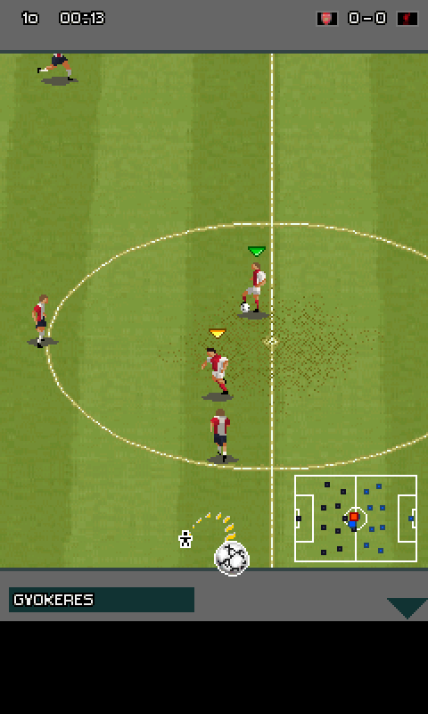
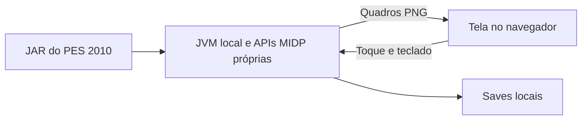
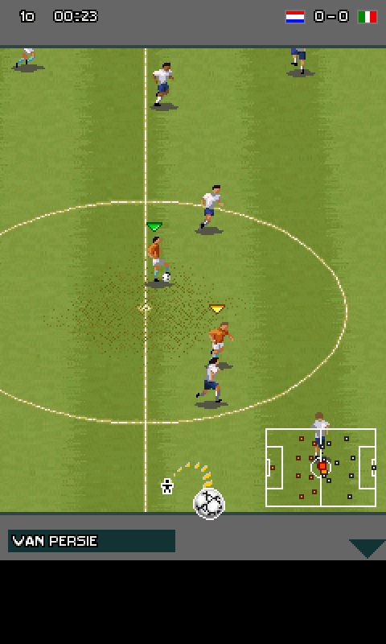
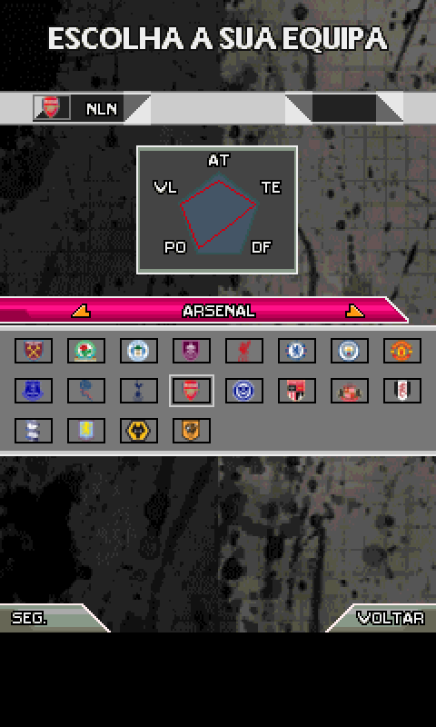
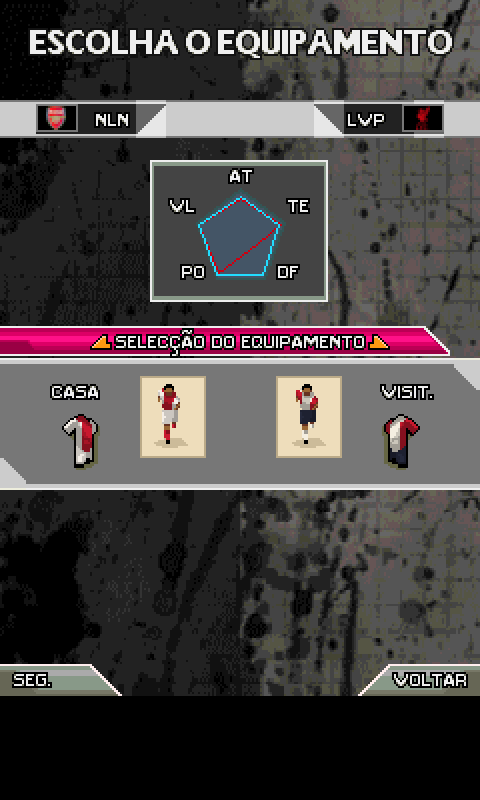

# Do Java de bolso ao navegador com PES 2010

**Um JAR de 2009, um runtime MIDP escrito para o projeto e um Arsenal × Liverpool com elencos de 2026/27.**

O placar marca 00:13. A bola ainda está perto do círculo central, os escudos de Arsenal e Liverpool aparecem no topo e o nome no canto é **Gyökeres**. A partida está rodando no navegador. Quem movimenta os jogadores é o mesmo código Java que rodava no celular.

*Arsenal × Liverpool na edição 2026/27, capturado após o pontapé de saída.*

## Abrir o JAR foi a parte fácil

O manifesto apontava para uma classe chamada `a`. Ao redor dela estavam a tela, o campo, os jogadores, a bola, a matemática e o desenho. O pacote também tinha arquivos sem extensão, com nomes de uma letra. Um deles começava com a assinatura de um PNG. Parecia uma imagem até a gente seguir os offsets e descobrir que havia mais conteúdo no mesmo arquivo.

A documentação separou três decisões que acontecem em paralelo. A interface sabe se está no menu ou na partida. O árbitro sabe se a bola está em jogo ou precisa ser reposta. Cada jogador decide como se mover ou reagir. Na partida, o motor atualiza a bola, reorganiza as equipes, aplica as decisões do árbitro e avança os jogadores. A ordem ajuda a explicar por que uma bola aparentemente solta já tem alguém correndo para o ponto onde ela vai cair. [Guia do motor](Guia.md) · [Mapa dos recursos](Formatos-binarios.md)

A tela também guardava uma surpresa. O jogo desenha em **240×400** e duplica os pixels para exibir **480×800**. A entrada segue a operação inversa. Antes de decidir qual botão ou região recebeu o toque, ele divide as coordenadas por dois. Em tela cheia, essa relação precisa sobreviver a mais uma mudança de escala.

## O navegador virou a tela do celular

O projeto implementa o subconjunto das APIs MIDP de que o jogo precisa. A JVM local lê o manifesto e executa a classe original. A camada de compatibilidade traduz operações de desenho para Java 2D e grava os dados de progresso com uma implementação local do RMS. O navegador recebe os quadros e devolve toques e teclas.

Uma diferença pequena apareceu na pior hora. O menu carregava, mas, na entrada do campo, o jogo tentava desenhar um recorte de altura zero. O Java 2D rejeitava o recorte. Tratar aquele desenho vazio como uma operação sem efeito permitiu concluir a entrada e chegar ao pontapé de saída.

*Uma partida com o JAR original na camada MIDP do projeto.* [Arquitetura e execução local](Runtime-Web.md)

## A janela de transferências coube em 16 vagas

O catálogo reserva **16 vagas por clube**. Cada vaga tem uma referência a um registro de jogador, e o nome ocupa um campo de comprimento variável. Para atualizar os elencos, foi preciso reconstruir esse catálogo e recalcular os offsets. A seleção de atletas usa a posição e as participações registradas na fonte. Atributos, aparência em campo e dorsais seguem a lógica dos slots existentes.

O pacote resultante atualizou **89 dos 104 clubes**, com escudos na seleção e no placar. Para **24 clubes**, também houve ajuste nas paletas do uniforme principal e do alternativo. Os escudos precisaram caber em espaços de poucos pixels. Já os kits usam os recortes e as sombras que o motor conhece, com cores aproximadas da temporada.

| Escudos na seleção | Uniformes no menu |
|---|---|
|  |  |

A edição atualizada fica em uma cópia local do JAR, com saves próprios. Arsenal × Liverpool foi o teste que reuniu as três mudanças num só quadro. [Como a atualização foi feita](Temporada-2026.md) · [Clubes, cobertura e fontes](Clubes-2026.md)

## Quanto desse celular cabe na Web?

O projeto já leva o jogo do menu ao campo. A tela pode ser ampliada e suavizada no navegador, com os toques ainda mapeados para a resolução original. O áudio continua pendente. Uma versão com gráficos realmente HD exigiria arte em resolução maior e uma camada que soubesse quais recortes desenhar sem mexer nas coordenadas usadas pela partida.

Por enquanto, a prova cabe numa cena curta. Um toque no controle de saída, o relógio começa a correr e o nome de Gyökeres aparece justo no lugar onde o telefone mostrava o nome de quem estava com a bola.
