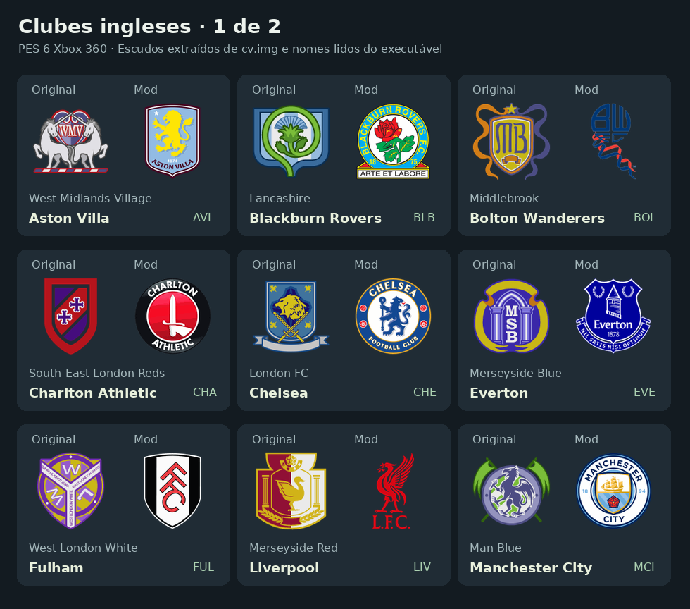

# How to update your PES 6 Option File on Xbox 360

If you want to correct a player name, the Xbox 360 version has an in-game editor and can save the change as Edit Data. If you want **Merseyside Red → Liverpool** with the real crest, the workflow demonstrated here uses a separate patch to the game files.



*Before and after, assembled from the installed game files. The labels were read back from the modified executable.*

## Update your Option File for player edits

1. Back up your current PES 6 save before experimenting. Keep the copy separate from your active profile or emulator storage.
2. Launch **PES 6 for Xbox 360**, open **Edit**, and choose a player. Correct a name as a small test, then save the Edit Data.
3. Close and reopen the game using the same profile and storage. Open that player again and check that the change persisted.

The contemporary PESFan instructions for the Xbox 360 release describe player names and attributes among the fields available in its reduced editor. The executable studied here lists both `PES6_EDIT00.bin` and `PES6_OPTION00.bin`. The edits made through the game should be tested with a save created by that exact release and profile. A replacement from a different release, console family or container may need a separate compatibility check. [Contemporary PESFan instructions reproduced on Neoseeker](https://forums.neoseeker.com/32467/t773458-some-box-360-downloads/)

If you already have a copy of the file, you can record its fingerprint before and after the test. The CLI reads the file and reports the SHA-256 and a container hint. Save rewriting and cross-profile conversion remain unverified.

```sh
pes6-x360 option-info /path/to/PES6_EDIT00.bin
```

## Restore club names and crests in an extracted game for Xenia

The on-disk team table and the crest banks are the route we verified for this change. It uses the **TriploPlayBR** Xbox 360 build with Title ID `4B4E07DA` and Media ID `617138EB`. The CLI checks the exact original executable hash, then creates a separate game directory. The original game files and the contents of its player and roster banks remain available.

Clone this repository, [install the CLI](../../tools/pes6-x360/README.md), and install [xex2ool](https://github.com/landaire/acceleration/releases). Then run:

```sh
pes6-x360 fetch-logos ./logos
pes6-x360 apply "/path/to/original/PES 6" "./PES 6 - Real Clubs" --logos ./logos
pes6-x360 verify "/path/to/original/PES 6" "./PES 6 - Real Clubs"
```

Open `PES 6 - Real Clubs/default.xex` in Xenia Canary. Open the team selection screen and check **Liverpool**, **Chelsea** and **Manchester City**. If you have an existing local Edit Data file, keep a backup and test with a fresh emulator profile so you can isolate what the game is reading from the base files.

The modified executable booted in Xenia Canary and the log showed the game opening `cv.img`. We checked all **27 names and abbreviations**, **54 changed images** and **414 internal name pointers** directly in the output. Full visual verification at the team selection screen and testing on physical hardware remain pending.

## Where the changes land

| What changes | Where the build stores it |
|---|---|
| Club name and abbreviation | Two big-endian pointers in a 24-byte row in the embedded PE. Liverpool is row 72, at PE file offset `0xD558D8`. |
| Crest | Slot 65 for Liverpool in both `cv.img[2710]` (128×128) and `cv.img[2711]` (64×64). |
| Players and shirt numbers | The separate `cv.img[6667]` and `cv.img[6668]` data banks. Their row orders differ in part of the catalog. |

The crest banks contain compressed WE00 images and a table of internal names at the end. The patcher keeps those names and updates their pointers when image sizes change. Preserving the table matters because the location of every later image can move after re-encoding a single one. [Original club-name equivalences](https://www.cultoretro.top/pes/pes6/guia-de-nombres-reales-estadios-y-equipos/) · [CLI source and usage](../../tools/pes6-x360/README.md)
